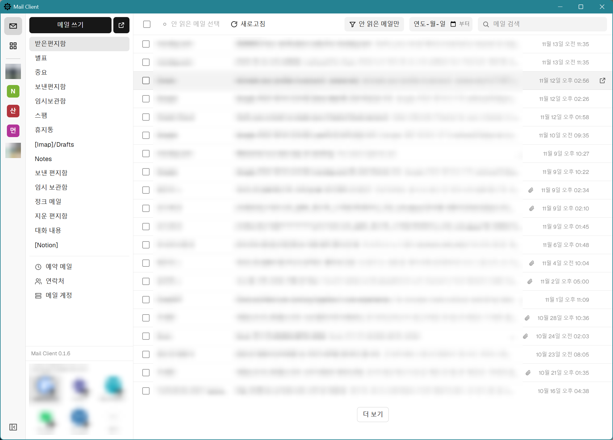
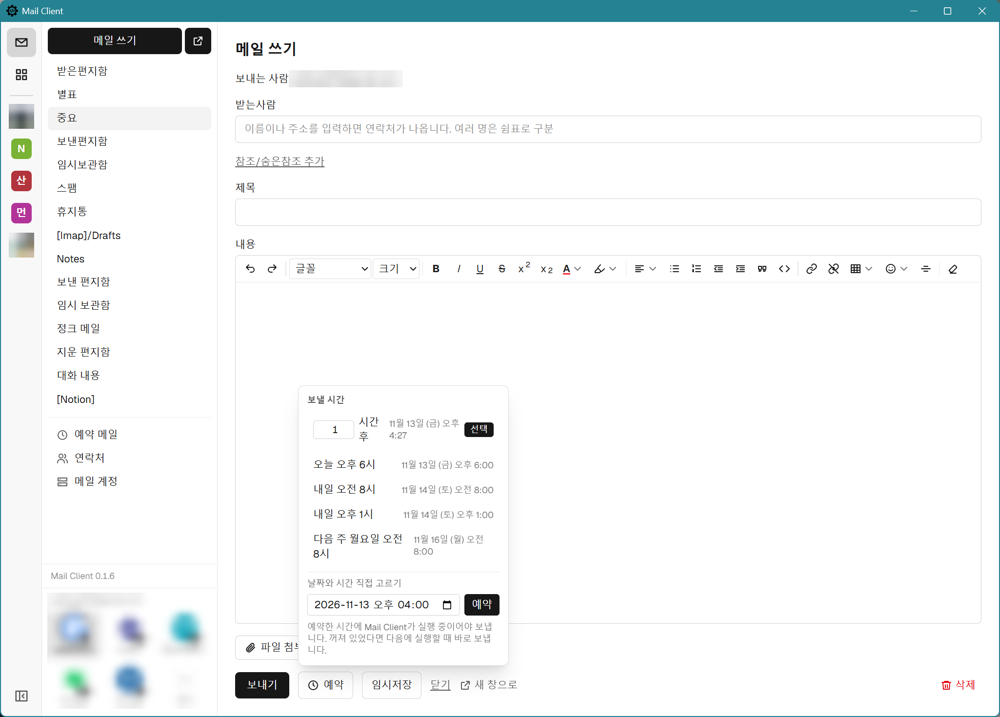
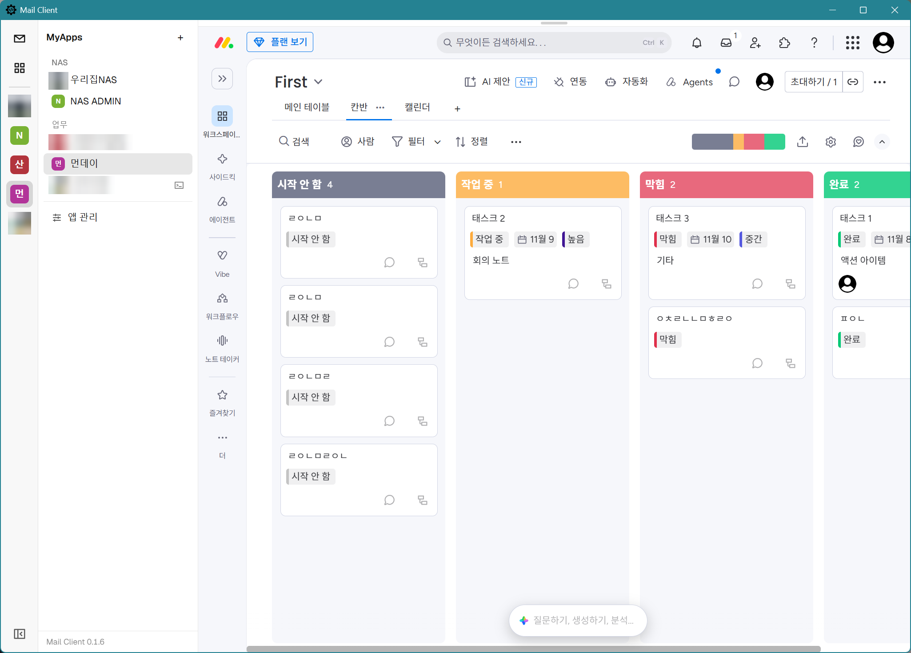
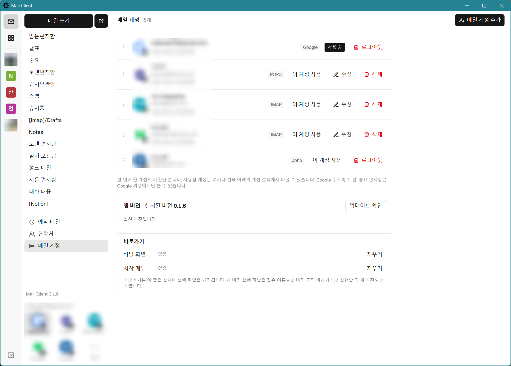

# Mail Client (myMailClient)

Gmail(Gmail API)과 네이버 등 IMAP/SMTP 메일 계정을 함께 쓰는 Windows 데스크톱 이메일 클라이언트입니다.
계정은 여러 개 추가할 수 있고, 왼쪽 아래 계정 선택이나 **메일 계정** 화면에서 사용할 계정을 고릅니다.
화면은 Next.js, 실행은 Electron으로 구성되며, 서버를 따로 실행하지 않습니다.

## 화면

| 메일 목록 | 메일 쓰기와 보내기 예약 |
| --- | --- |
|  |  |
| **MyApps: 웹앱을 앱 안에서 열기** | **메일 계정 관리** |
|  |  |

개인정보가 보이는 부분은 흐리게 처리했습니다.

## 준비

Google 로그인(Gmail API·Google 주소록)은 **선택 사항**입니다. 아래 설정 없이 빌드하면 Google 로그인만 빠지고,
IMAP·POP3 계정(Gmail도 앱 비밀번호로 IMAP 연결 가능)은 그대로 쓸 수 있습니다. 남에게 나눠 줄 실행 파일은
`.env.local` 없이 빌드하세요. 있으면 클라이언트 ID와 시크릿이 실행 파일 안에 들어갑니다.

Google 로그인을 쓰려면:

1. [Google Cloud Console](https://console.cloud.google.com/)에서 **Gmail API**와 **People API**(연락처)를 사용 설정합니다.
2. **Google 인증 플랫폼 → 대상**에서 사용할 Gmail 계정을 테스트 사용자로 추가합니다.
   **데이터 액세스**에는 다음 범위를 추가합니다.
   - `https://www.googleapis.com/auth/gmail.modify`
   - `https://www.googleapis.com/auth/contacts` (Google 주소록 읽기·추가)
   - `https://www.googleapis.com/auth/contacts.other.readonly` (메일을 주고받은 사람)
3. **Google 인증 플랫폼 → 클라이언트**에서 애플리케이션 유형을 **데스크톱 앱**으로 선택해 클라이언트를 만듭니다.
   리디렉션 URI는 등록하지 않아도 됩니다.
4. `.env.example`을 `.env.local`로 복사하고 클라이언트 ID와 시크릿을 넣습니다.
   `.env.local` 없이 만든 실행 파일(배포용, 맥용)에서는 **메일 계정 추가 → Gmail (Google 로그인)** 화면에 클라이언트 ID와 시크릿을 직접 넣어도 됩니다(이 컴퓨터에만 암호화해 저장).

Google 계정은 여러 개 추가할 수 있습니다. 추가할 계정마다 위 2단계의 테스트 사용자로 등록되어 있어야 합니다.
Google 주소록은 사용 중인 계정이 Google 계정이면 그 계정의 것을, 아니면 목록의 첫 Google 계정의 것을 씁니다.

## 네이버 등 IMAP 계정

**메일 계정 → 메일 계정 추가**에서 추가합니다. 저장할 때 IMAP·SMTP 서버에 실제로 로그인해 보고, 성공해야 저장됩니다.

- 네이버: 메일 환경설정에서 **IMAP/SMTP 사용함**으로 바꿉니다. 로그인 비밀번호가 거부되면 2단계 인증의 **애플리케이션 비밀번호**를 만들어 입력합니다. (imap.naver.com:993, smtp.naver.com:465, SSL)
- Zoho(회사 도메인): Zoho 메일 설정 → 메일 계정 → IMAP에서 **IMAP 액세스**를 켭니다. 2단계 인증을 쓰면 **앱 비밀번호**를 만들어 입력합니다. (imappro.zoho.com:993, smtppro.zoho.com:465, SSL)
- IMAP 계정은 메일 한 통을 대화 하나로 보여 주며, 검색은 받은편지함에서 합니다. Google 주소록·보관·중요 편지함은 Google 계정 전용입니다.
- 서버 설정은 `%APPDATA%\Mail Client\accounts.json`에, 비밀번호는 `safeStorage`로 암호화해 같은 파일에 저장합니다.

## Zoho 메일 (Zoho 로그인)

Zoho 무료(Forever Free) 플랜은 IMAP·POP·SMTP를 제공하지 않으므로, Zoho Mail API로 연결합니다(유료 플랜도 같은 방법으로 쓸 수 있습니다).
**메일 계정 → 메일 계정 추가 → Zoho 메일 (Zoho 로그인)**에서 추가합니다.

1. [Zoho API 콘솔](https://api-console.zoho.com/)에서 **ADD CLIENT → Non-browser Applications**로 클라이언트를 만듭니다.
2. 앱에 Client ID·Client Secret과 데이터 센터(api-console.zoho.com이면 미국)를 넣고 저장합니다.
3. **Zoho 계정으로 로그인**을 누르면 브라우저에 Zoho 승인 화면이 열립니다. 코드를 확인하고 승인하면 계정이 추가됩니다.

- 클라이언트와 리프레시 토큰은 `safeStorage`로 암호화해 `%APPDATA%\Mail Client\zoho.bin`에 저장합니다. 실행 파일에는 들어가지 않습니다.
- 메일 한 통을 대화 하나로 보여 주며, 검색은 Zoho 검색으로 합니다(제외 조건 `-`과 숨은참조 검색은 지원하지 않습니다). 별표는 Zoho의 '중요' 플래그입니다.

## 보내기 예약

메일 쓰기의 **예약**에서 보낼 시간(N시간 후, 내일 오전 8시 등, 또는 직접 입력)을 고릅니다. 모든 계정에서 같은 방식으로 동작합니다.

- 예약한 메일은 첨부까지 이 PC(`%APPDATA%\Mail Client\scheduled`)에 `safeStorage`로 암호화해 두고, 임시보관함의 같은 메일은 지웁니다.
- **예약한 시간에 앱이 실행 중이어야 보냅니다.** 꺼져 있었다면 다음에 실행할 때 바로 보내고 Windows 알림으로 알려 줍니다.
- 사이드바의 **예약 메일**에서 지금 보내기·시간 바꾸기·수정(임시보관함으로 되돌려 이어 쓰기)·예약 취소·삭제를 합니다. 보내지 못한 메일은 이유와 함께 남습니다.
- 보내는 도중 앱이 꺼진 메일은 실제로 나갔는지 알 수 없어 다시 보내지 않고 확인을 기다립니다.

## 명령어

| 명령어 | 설명 |
| --- | --- |
| `npm run dist` | 이 PC용 실행 파일 생성 → `release/MailClient-<버전>-local.exe`. `.env.local`의 Google 키가 들어가므로 남에게 주지 마세요. 실행 방식은 아래 `dist:public`과 같고, Rust(`cargo`)가 필요합니다 |
| `npm run dist:public` | 남에게 줄 실행 파일 생성 → `release/MailClient-<버전>.exe`. Google 키를 넣지 않고, 처음 실행하면 exe 옆 `Mail Client` 폴더에 앱을 풀어 둔 뒤 실행합니다(이후 실행은 바로 시작). Rust(`cargo`)가 필요합니다 |
| `npm run dist:mac` | 맥용 앱 생성 → `release/MailClient-<버전>-mac-arm64.dmg`(M1 이후), `-mac-x64.dmg`(Intel). macOS에서만 실행됩니다. 아래 **맥(macOS)** 참고 |
| `npm start` | 빌드 후 앱 실행 |
| `npm run dev` | 개발 모드 (Next 개발 서버 + 앱). `src/` 수정은 즉시 반영, `electron/`·`.env.local` 수정은 앱 자동 재시작. 앱 창을 닫으면 종료 |
| `npm test` | 단위 테스트 |
| `npm run typecheck` / `npm run lint` | 타입 검사 / ESLint |

### 자동 업데이트

`MailClient-<버전>.exe`로 실행한 앱은 시작할 때 한 번 GitHub의 최신 릴리스를 확인합니다(실행 중에는 **메일 계정 → 업데이트 확인**을 누를 때만). 새 버전이 있으면 업데이트할지 묻고, 업데이트하면 진행 상태를 보여 주며 받아 크기·SHA-256(GitHub가 계산한 값)·패키지 형식을 확인한 뒤 다시 시작할지 묻습니다. 나중에 하면 앱을 종료할 때 실행 파일을 같은 이름으로 바꿔 둡니다(다음 실행 때 새 버전으로 풀림). **메일 계정** 화면이나 왼쪽 아래 알림의 **다시 시작**을 누르면 바로 적용합니다.

- 릴리스에는 `npm run dist:public`으로 만든 `MailClient-<버전>.exe`를 그 이름 그대로 올려야 하고, 태그는 `v<버전>`이어야 합니다.
- `npm run dev`와 `-local.exe`(Google 키가 들어간 빌드)는 자동 업데이트를 하지 않습니다.
- 업데이트를 시험하려면 `MAIL_CLIENT_UPDATE_FEED=<로컬 주소>`를 설정해 `npm run dist:public`으로 빌드합니다. 이렇게 만든 exe는 배포하지 마세요.

`release/` 폴더의 `.exe` 파일 하나만 있으면 설치 없이 실행됩니다(처음 실행할 때 exe 옆에 `Mail Client` 폴더를 만듭니다).
코드 서명을 하지 않았으므로 처음 실행할 때 Windows SmartScreen 경고가 나오면 **추가 정보 → 실행**을 누릅니다.

## 맥(macOS)

맥용 앱은 GitHub Actions의 macOS 빌드 서버에서 만듭니다(`.github/workflows/mac.yml`). Mac이 없어도 됩니다.

- **릴리스할 때**: 릴리스를 게시하면 몇 분 뒤 `MailClient-<버전>-mac-arm64.dmg`(M1 이후)와 `-mac-x64.dmg`(Intel)가 그 릴리스에 자동으로 붙습니다.
  릴리스 태그와 `package.json`의 버전이 같아야 합니다.
- **시험 빌드**: **Actions → Mac app → Run workflow**를 누르면 dmg가 실행 결과의 **Artifacts**(`mac-app`)로만 나옵니다(GitHub 로그인 필요).

Mac에서 설치하기:

1. [최신 릴리스](https://github.com/HaeJue-LEE/myMailClient/releases/latest)에서 내 Mac에 맞는 dmg를 받습니다.
   Apple 메뉴 → 이 Mac에 관하여에서 칩이 'Apple M…'이면 `-mac-arm64.dmg`, Intel이면 `-mac-x64.dmg`입니다.
2. dmg를 열고 **Mail Client**를 **Applications**(응용 프로그램) 폴더로 끌어 놓습니다.
3. Apple 개발자 서명이 없어 그냥은 열리지 않습니다. 터미널에서 다음을 실행한 뒤 응용 프로그램 폴더에서 엽니다.
   ```
   xattr -dr com.apple.quarantine "/Applications/Mail Client.app"
   ```
   (경고 창에 따라 **시스템 설정 → 개인정보 보호 및 보안 → 그래도 열기**로 열리는 경우도 있습니다.)
4. 계정을 처음 저장할 때 키체인 접근을 물으면 **항상 허용**을 누릅니다(비밀번호를 키체인으로 암호화합니다).
   새 버전으로 바꾼 뒤에는 한 번 더 물을 수 있습니다.

새 버전:

- 앱을 시작할 때 GitHub의 최신 릴리스를 확인하고, 내 Mac용 dmg가 붙은 새 버전이 있으면 알려 줍니다.
- **새 버전 받기**를 누르면 앱이 dmg를 다운로드 폴더에 받아 크기와 SHA-256을 확인합니다. **설치**를 누르면 dmg가 열리고 앱이 종료되니,
  Mail Client를 Applications 폴더로 끌어 놓고 **대치**를 누른 뒤 다시 엽니다. 계정과 설정은 그대로 남습니다.
- 앱이 직접 받은 dmg에는 "인터넷에서 받은 파일" 표시가 붙지 않아, 새 앱을 열 때 터미널 명령이 필요 없습니다.
  브라우저로 받았다면(**다운로드 페이지 열기**) 위 3단계의 터미널 명령을 다시 실행합니다.
- 맥용 앱은 서명이 없어 스스로 바뀌지 않습니다. Windows처럼 받아서 다시 시작하는 자동 업데이트는 없습니다.

그 밖에:

- Google 키가 들어 있지 않습니다. Google 로그인(Gmail API)을 쓰려면 **메일 계정 추가 → Gmail (Google 로그인)**에 직접 만든 클라이언트 ID와 시크릿을 넣습니다(위 **준비** 참고). 앱 비밀번호로 IMAP 계정으로 추가해도 됩니다.
- MyApps의 **이 컴퓨터의 프로그램**으로 맥 앱(`.app`)이나 터미널 스크립트(`.command`)를 고를 수 있습니다. 바로 가기는 Windows 전용입니다.
- 설정과 계정은 `~/Library/Application Support/Mail Client`에 저장됩니다. Windows에서 쓰던 계정 파일은 옮겨도 열리지 않습니다.

## 구조

```
electron/            메인 프로세스 (Node.js)
  main.ts            창, app:// 프로토콜, 외부 링크 처리
  auth.ts            Google 로그인(시스템 브라우저 + 루프백), 토큰 암호화 저장
  accounts.ts        IMAP 계정 목록과 사용 중인 계정 (비밀번호 암호화 저장)
  backend.ts         계정 종류와 무관한 메일 기능 인터페이스, 사용 중인 계정 선택
  ipc.ts             화면 요청 검증 후 사용 중인 계정의 백엔드 호출
  preload.ts         화면에 window.mailApi만 노출
  gmail/             Gmail 서비스, 메시지 파싱, MIME 생성
  imap/              IMAP 연결·폴더 매핑·검색 변환·메시지 파싱, SMTP 전송
  pop3/              POP3 연결, 로컬 저장소(읽음·임시보관·보낸편지)
  zoho/              Zoho 로그인(device flow)·토큰, Zoho Mail API 백엔드
src/                 화면 (Next.js 정적 내보내기 → out/)
  app/               /login, /mail?label=…&thread=…, /mail/compose
  features/mail/     컴포넌트, React Query 훅, 브리지 타입, HTML 정화
scripts/             Electron 번들 스크립트 (esbuild)
```

## 설계 원칙

- **화면은 Google 토큰을 받지 않습니다.** Gmail 호출은 메인 프로세스만 하고, 화면은 IPC로 결과만 받습니다.
- **토큰은 Windows 사용자 계정으로 암호화됩니다.** Google 계정들의 리프레시 토큰은 `safeStorage`(DPAPI)로 암호화해 `%APPDATA%\Mail Client\google.bin`에 저장합니다.
- **로그인은 시스템 브라우저에서 합니다.** Google이 앱 내장 브라우저 로그인을 차단하기 때문입니다.
- **메일 HTML은 신뢰하지 않습니다.** DOMPurify로 정화하고 CSP를 적용한 샌드박스 iframe에 표시하며, 링크는 기본 브라우저로 엽니다.

## 운영 시 주의사항

- OAuth 앱이 "테스트" 상태이면 **리프레시 토큰이 7일 후 만료**되어 다시 로그인해야 합니다.
- `gmail.modify`는 Google의 **제한된 범위**입니다. 불특정 사용자에게 배포하려면 OAuth 앱 검증이 필요합니다.
- `.env.local`이 있으면 클라이언트 ID와 시크릿이 실행 파일에 포함됩니다. 데스크톱 앱용 클라이언트에서는 Google도 이 값을 비밀로 취급하지 않으며, PKCE가 로그인을 보호합니다. 다만 실행 파일을 공개하면 누구나 이 값을 꺼내 같은 앱 이름으로 로그인 화면을 띄울 수 있으니, 배포용은 `.env.local` 없이 빌드하세요.

## 라이선스

[MIT License](LICENSE)로 공개합니다. 저작권 표시와 라이선스 문구를 남기면 자유롭게 사용·수정·배포할 수 있으며, 소프트웨어는 어떠한 보증 없이 "있는 그대로" 제공됩니다.
